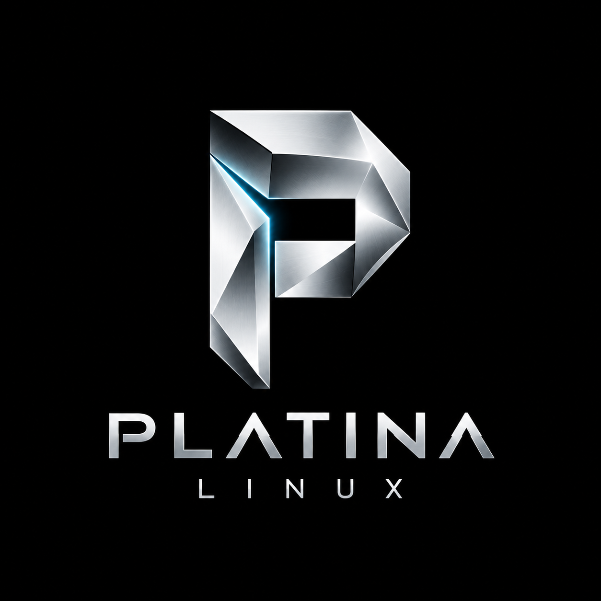

<p align="center">
  
</p>

# Platina Linux for Xiaomi Mi 8 Lite

Turn a **Xiaomi Mi 8 Lite (platina, M1808D2TG, Qualcomm Snapdragon 660 / SDM660)**
into a small **headless Linux server** with Wi-Fi, USB networking and SSH.
Platina Linux is a device integration built on **postmarketOS and Alpine Linux**,
using the SDM660 mainline-oriented kernel port. It boots Linux directly from eMMC;
this is not Android, a container inside Android, or a desktop phone OS.

[](https://github.com/Sukecz/platina-linux/actions/workflows/check.yml)
[](LICENSE)
[](docs/HARDWARE.md)

**Verified existing-installation integration: 0.3.1** · **Kernel: 7.2.12-r1 / 7.2.12-sdm660** · **Development / early hardware testing**

**Source/build integration: 0.3.1.** Fresh image builds include both screens,
display helpers and the shutdown service. The tested phone was updated in place
to 0.3.1, with screen preview and normal restart verified. The newly built full
installation image passed offline audits and has not been flashed as a full image.

[Installation](docs/INSTALLATION.md) · [Build from source](docs/BUILDING.md)
· [Display development](docs/DISPLAY.md) · [Shutdown](docs/SHUTDOWN.md)
· [Changelog](CHANGELOG.md) · [Licensing](docs/LICENSING.md)

## What it does

- **Real Linux on the phone:** an ARM64 Alpine userspace, package manager and OpenRC services.
- **Remote administration:** key-only OpenSSH over Wi-Fi or the USB network gadget,
  with root login and SSH password login disabled.
- **Reconnect automatically:** NetworkManager restores the configured Wi-Fi connection;
  USB networking provides a separate local administration path.
- **Headless by default:** keep the backlight dark while running background services.
- **Battery and charger operation:** use Wi-Fi while running on the battery or a separate charger.
- **Integrated Tianma display:** boot logo, brightness and ten repeated display
  off/on cycles have been physically verified. Full LCD rail shutdown remains pending.
- **Repeatable development:** pinned source revisions, versioned recipes, checksum
  verification, offline tests and separate build/export/audit steps.

The goal is a practical always-on server. **Long-term 24/7 stability and sustained
power balance have not yet been qualified.** Existing phone components keep their
own support limits; this project does not claim full smartphone functionality.

## Feature status

**Last reviewed: 2026-10-23.** Status describes tests on the maintainer's Mi 8 Lite,
not a guarantee for every device or panel variant.

🟢 **Verified** · 🟠 **Partial / prepared / awaiting hardware testing** · 🔴 **Not working / unsupported**

| Feature | Status | What has been verified |
|---|:---:|---|
| Linux boot from internal eMMC | 🟢 | Installed system, normal startup and repeated restarts |
| ARM64 userspace and OpenRC | 🟢 | postmarketOS v26.06 / Alpine; services start after boot |
| SSH over Wi-Fi | 🟢 | Direct LAN login with an administrator key |
| SSH over USB networking | 🟢 | USB gadget administration on a Linux host |
| SSH authentication hardening | 🟢 | Password and root SSH login disabled; administrator uses sudo |
| Wi-Fi reconnect | 🟢 | Reconnect after radio recovery; network configuration persists |
| USB network recovery | 🟢 | Software disconnect/reconnect and address recovery |
| mDNS hostname | 🟢 | `platina.local` on a compatible local network |
| eMMC / ext4 storage | 🟢 | Read/write root filesystem and offline image checks |
| Battery operation | 🟢 | Wi-Fi administration with data USB physically disconnected |
| Separate charger operation | 🟢 | Operation and charging confirmed with a suitable charger/cable |
| Battery / thermal telemetry | 🟢 | Battery information and CPU, GPU and battery temperature readings |
| Physical shutdown buttons and screen | 🟢 | Power + Volume Up held for 3 s, release both; Power off logo and battery shutdown physically verified |
| Staying off while USB power is connected | 🔴 | Accepted limitation: disconnect USB/charger before shutdown; otherwise the bootloader starts Linux again |
| Short boot logo | 🟢 | Automatic logo and subsequent shutdown physically confirmed after normal boot in 0.2.0 |
| Integrated Tianma NT36672A panel driver | 🟢 | Kernel 7.2.12-r1: RAM boot, normal eMMC boot, image and ten off/on cycles verified |
| Display power, brightness and custom images | 🟠 | Brightness and driver powerdown verified; VSP/VSN remain fixed always-on. Custom-image conversion tested offline |
| Beszel monitoring | 🟠 | Native monitoring tested separately; optional custom hub/power-chart integration is outside this source base |
| VPN access from outside the home network | 🟠 | A LAN jump-host route was tested; a real off-site client test is pending |
| Continuous 48–72-hour uptime | 🟠 | Qualification is pending; shorter successful tests are not a soak test |
| Sustained charging / wall power use | 🟠 | Short charger tests passed; long-term balance and wall-meter measurements are pending |
| CPU frequency scaling | 🟠 | Port/platform limitation; no supported full scaling claim |
| Audio, Bluetooth, camera and SD card | 🟠 | Not functionally qualified by this project |
| Touchscreen on the tested device | 🔴 | Controller initialization fails; headless administration is unaffected |
| Mobile calls / mobile data | 🔴 | Outside the supported headless-server feature set |
| Android apps / Android services | 🔴 | This system replaces the running Android environment |
| Other Xiaomi Mi 8 models / other phones | 🔴 | This port targets **Mi 8 Lite / platina only** |

To switch the phone off and keep it off, **disconnect USB/the charger first**,
hold **Power + Volume Up for at least 3 seconds**, then release both buttons.
The Platina logo and Power off screen appear during shutdown. The shutdown
service is enabled; experimental PMIC trigger changes are not loaded automatically.

The checked-in candidate sources are **kernel 7.2.12-r1 + device 5-r31**. The
physically verified 0.2.0 installation uses that kernel with device 5-r30 and
the documented runtime initramfs adjustments. The public firmware recipe is 2-r5, with a newly written packaging
helper; proprietary firmware payloads are supplied locally by each builder.
No prebuilt installation images or binary firmware are published here.

## Hardware

**Tested:** Xiaomi Mi 8 Lite, model **M1808D2TG**, codename **platina**, Snapdragon 660,
4 GB RAM / 64 GB eMMC, **Tianma NT36672A 1080 × 2280 LCD**.
Other RAM/storage variants and BOE panel variants are not qualified. Check the
codename and actual panel before using the display candidate. The Mi 8, Mi 8 SE,
Mi 8 Pro and Mi 8 Lite are different devices.

## Getting started

You need an unlocked bootloader, a Linux build host, your own SSH public key,
matching stock firmware inputs and a recovery plan. **Initial installation erases
Android user data.** Follow the [installation guide](docs/INSTALLATION.md), including
its backup, device identification and RAM-test stages before a permanent flash.

```sh
git clone https://github.com/Sukecz/platina-linux.git
cd platina-linux
make doctor
make check
```

The public tree contains the current port recipes, build and audit tools,
display sources, regression tests and documentation. Configuration, firmware,
phone backups and generated images remain local.

## Updating this project

The table above is maintained alongside code changes. A successful compilation
means **built**, an offline audit means **audited**, and a physical phone test means
**hardware verified**. These states are recorded separately.

Platina's integration version lives in `project/release.json`; it is independent
of the Linux and Alpine version numbers. Integration 0.2.0 records the physically tested Tianma driver; 0.3.0 adds
the shutdown chord and screen. Display rail and USB charger-boot limits are documented.

## Credits and license

Built on [postmarketOS](https://postmarketos.org/), [Alpine Linux](https://alpinelinux.org/),
[SDM660 mainline](https://github.com/sdm660-mainline/linux) and the
[community Mi 8 Lite port](https://github.com/macosmojave2-alt/postmarket-mi8lite-platina).
The panel sequence is based on Xiaomi's published kernel sources and matching
stock panel data. Original authors and source notices are retained.

**Original Platina contributions: GPL-2.0-only.** Third-party code retains its
own licenses; firmware remains proprietary and is not included. See
[LICENSE](LICENSE), [NOTICE](NOTICE) and the [licensing notes](docs/LICENSING.md).
